# Introduction (me)
::: {.hidden}
$$
\newcommand{\viva}{{\LARGE\bullet}}
\newcommand{\morta}{{\large\varnothing}}
\newcommand{\animal}[1]{\boxed{\text{#1}}}
\newcommand{\xe}{x_e}
\newcommand{\xd}{x_d}
\newcommand{\E}[1]{\mathbb{E}\!\left[#1\right]}
$$
:::


## A little about me {.nostretch}


:::: {.columns style="text-align: center;"}

::: {.column width="50%"}
### Bachelor's (2020-2024) · UFRGS

::: {.r-hstack style="gap: 0px; margin-bottom: 20px;"}
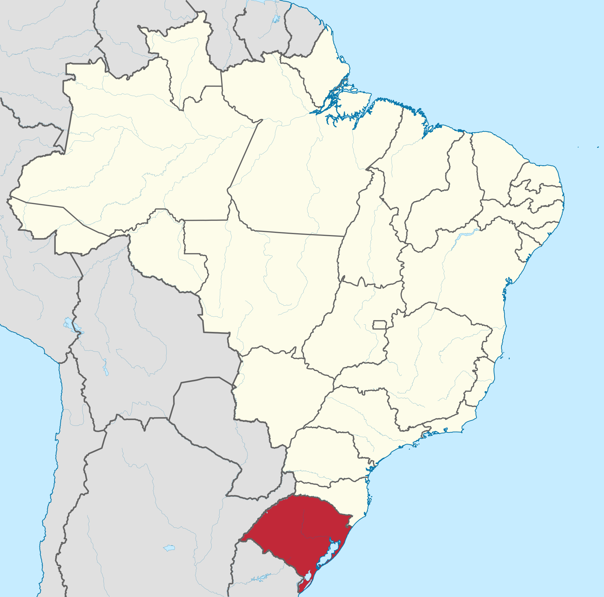{.foto height="180px"}

::: {.r-vstack style="gap: 0px;"}
::: {.r-hstack .cartao}

{height="80px"}

{height="40px"}

:::

{.foto width="180px"}

:::

:::

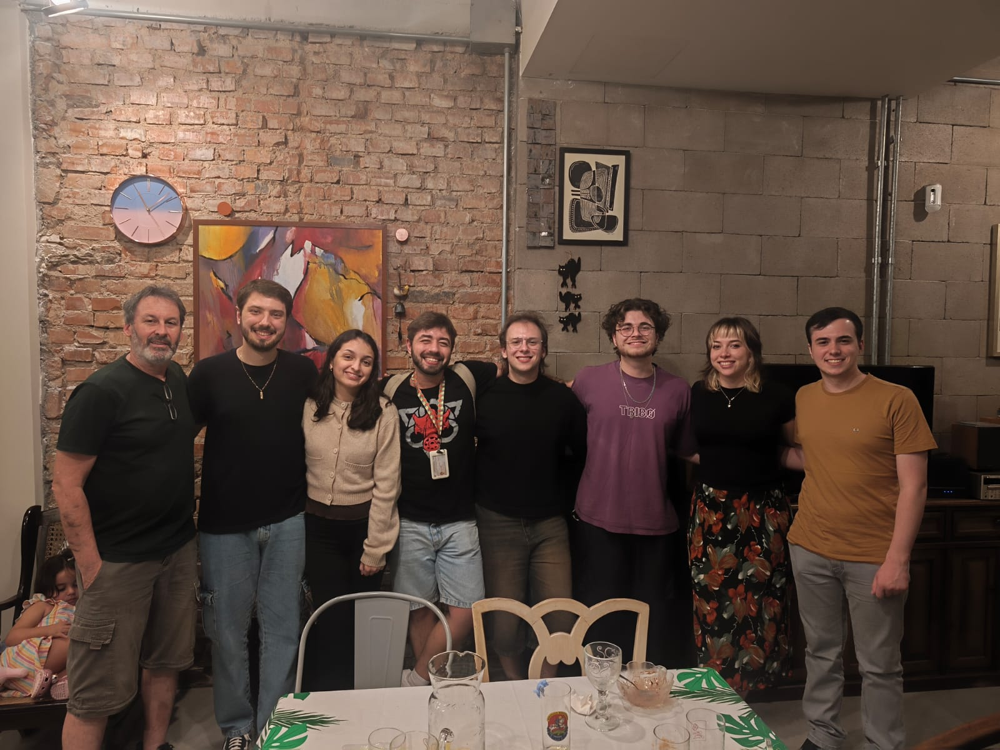{.foto width="800%" height="230px"}

:::{.texto style="font-size: 0.45em;"}
Worked on spatial game theory and how mobility can promote cooperation on the prisoner's dilemma game.
:::

:::


::: {.column .divisoria width="50%"}
### Master's (2025-2027?)· IFT–UNESP / CASUS


{height="220px"}

{.foto height="230px"}
:::

::::


# Introduction

## Animal-driven seed dispersal and modeling

::: {.r-stack}

::: {.fragment .fade-out fragment-index=3 style="width: 100%; margin-top: 0;"}
:::: {.columns .centro}

::: {.column .texto width="45%"}
::: {.fragment fragment-index=1}
- **70–90% of tropical forest plant species** are dispersed by animals (Willson et al. 1989)
:::

::: {.fragment fragment-index=1}
- **Zoochory**: seeds travel *with* the animal: epizoochory (fur), synzoochory (mouth, cheeks), **endozoochory** (gut passage).

- Where a seed lands depends on **where the animal ate** and **its movement**
:::

::: {.fragment fragment-index=2}
- **Spatial plant population models**: phenomenological kernel centred on the parent plant (e.g. Gaussian)
:::
:::

::: {.column style="width: 55%; align-self: flex-start;"}
::: {.r-stack}

::: {.fragment .fade-out fragment-index=2 style="width: 100%; margin-top: 0;"}
::: {.fragment fragment-index=1 style="width: 100%;"}
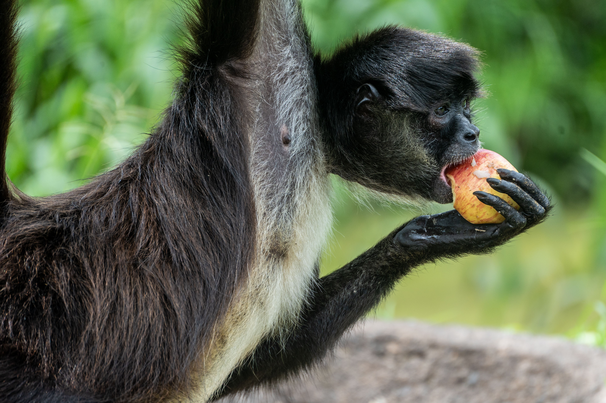{height="200px"}

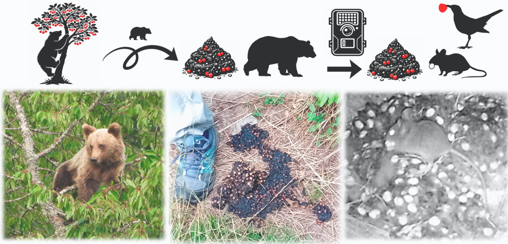{height="200px"}
:::
:::

::: {.fragment fragment-index=2 style="width: 100%; margin-top: 0;"}
{height="300px"}
:::

:::
:::

::::
:::

::: {.fragment fragment-index=3 style="width: 100%; margin-top: 0;"}
[**Do these kernels reproduce animal-mediated dispersal?**]{style="display: block; text-align: center;"}

:::: {.columns .centro}

::: {.column style="width: 33%; text-align: center;"}
{height="220px"}
:::

::: {.column style="width: 22%; text-align: center; font-size: 1.6em;"}
$\xrightarrow{\quad\;\textbf{?}\;\quad}$
:::

::: {.column width="45%"}
{height="210px"}
:::

::::

::: {.fragment fragment-index=4 style="text-align: center; font-size: 0.9em;"}
Not quite: range-residency plays a role.
:::
:::

:::


## Decoupling recruitment from parents

:::: {.columns .centro}

::: {.column .texto width="52%"}
- **Wiegand et al. (2021)**, ForestGEO megaplots + point pattern theory
- Recruits clustered **around parents** → **unstable** coexistence
- Recruits clustered **independently of parents** → **stable** coexistence

::: {.fragment fragment-index=1}
- **Our goal:** derive this decoupling **mechanistically**, by bringing animal movement into a spatial model of plant demography
:::

:::

::: {.column width="45%"}
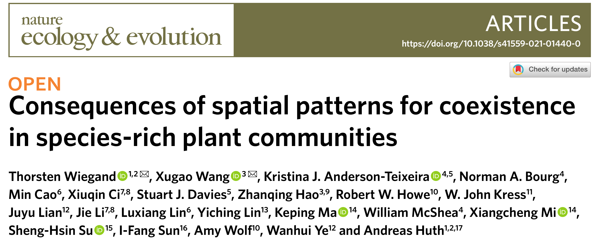{.foto width="90%"}
:::

::::

# Model  

## [[Original Model (birth-death dynamics)]{.fragment .fade-out fragment-index=3 style="margin: 0;"} [Our Model (birth-death dynamics)]{.fragment fragment-index=3 style="margin: 0;"}]{.r-stack style="justify-items: start;"}

[Surendran et al. (2025), *Physica D* 477]{.fragment .fade-out fragment-index=3 style="position: absolute; top: 70px; right: 0; font-size: 0.45em; color: #9aa5b1;"}

[Fundamental Process]{.kicker}

::::: {.fragment fragment-index=1}
:::: {.columns .centro .fila-modelo}
::: {.column .eq-modelo width="52%"}
::: {.r-stack}

::: {.fragment .fade-out fragment-index=3 style="width: 100%; margin-top: 0;"}
::: {.fragment .semi-fade-out fragment-index=2}
**Birth**

::: {.processo}
$\displaystyle \underset{\mathbf{x}_i}{\viva} \;\longrightarrow\; \underset{\mathbf{x}_i}{\viva} + \underset{\mathbf{x}}{\viva}$

$\displaystyle b\,
\underset{\substack{\big\uparrow \\ \text{Dispersal kernel} \\ \sim \mathcal{N}(0,\,s^2) \\ \text{centered at } \mathbf{x}_i}}
{\color{#7ee787}{\phi_D(\mathbf{x}-\mathbf{x}_i)}}$
:::
:::
:::

::: {.fragment fragment-index=3 style="width: 100%; margin-top: 0;"}
**Birth** (mediated by an animal)

::: {.subprocessos}
::: {.fragment .foco fragment-index=4}
[Ingestion]{.subproc}

::: {.processo}
$\displaystyle \underset{\mathbf{x}_A}{\animal{F}} \, + \, \underset{\mathbf{x}_i}{\viva} \;\longrightarrow\; \underset{\mathbf{x}_A}{\animal{D}} \, + \, \underset{\mathbf{x}_i}{\viva}$

$\displaystyle \omega_e \sum\nolimits_i K^E(\mathbf{x}_A - \mathbf{x}_i)$
:::
:::

::: {.fragment .foco fragment-index=5}
[Deposition]{.subproc}

::: {.processo}
$\displaystyle \underset{\mathbf{x}_A}{\animal{D}} \;\longrightarrow\; \underset{\mathbf{x}_A}{\animal{F}} \, + \, \underset{\mathbf{x}_A}{\viva}$

$\displaystyle \omega_d$
:::
:::

::: {.fragment .foco fragment-index=6}
[Movement]{.subproc}

::: {.processo}
$\displaystyle \underset{\mathbf{x}(t)}{\animal{F/D}} \;\xrightarrow{\;\Delta t\;}\; \underset{\mathbf{x}(t+\Delta t)}{\animal{F/D}}$

$\displaystyle \text{OU propagator}$
:::
:::
:::
:::

:::
:::

::: {.column width="45%"}
::: {.r-stack}
::: {.fragment .fade-out fragment-index=3}
::: {.fragment .semi-fade-out fragment-index=2}
{height="245px"}
:::
:::

::: {.fragment .fade-in-then-out fragment-index=4}
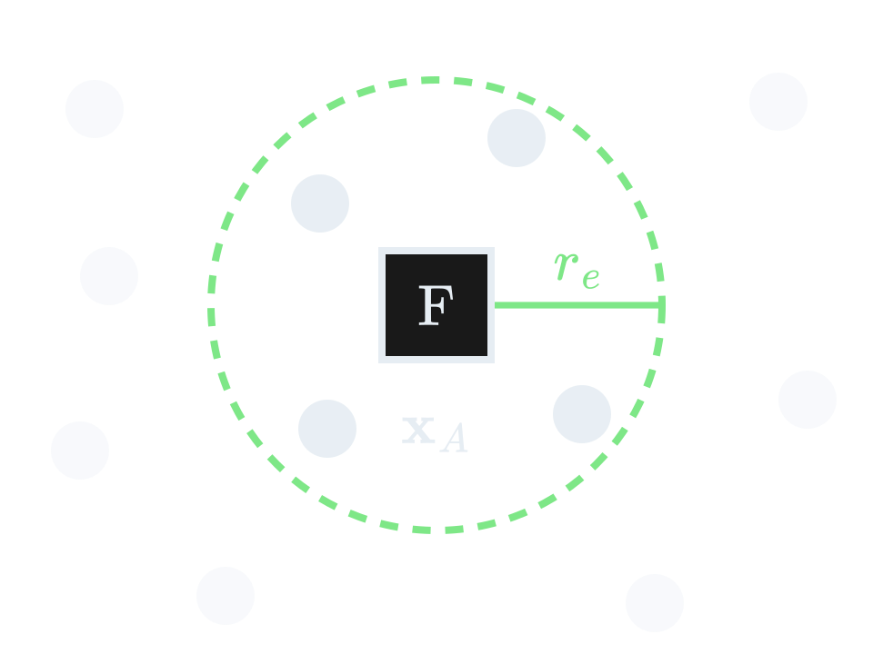{height="285px" style="margin-left: 64px;"}
:::

::: {.fragment .fade-in-then-out fragment-index=5}
{height="285px" style="margin-left: 64px;"}
:::

::: {.fragment fragment-index=6}
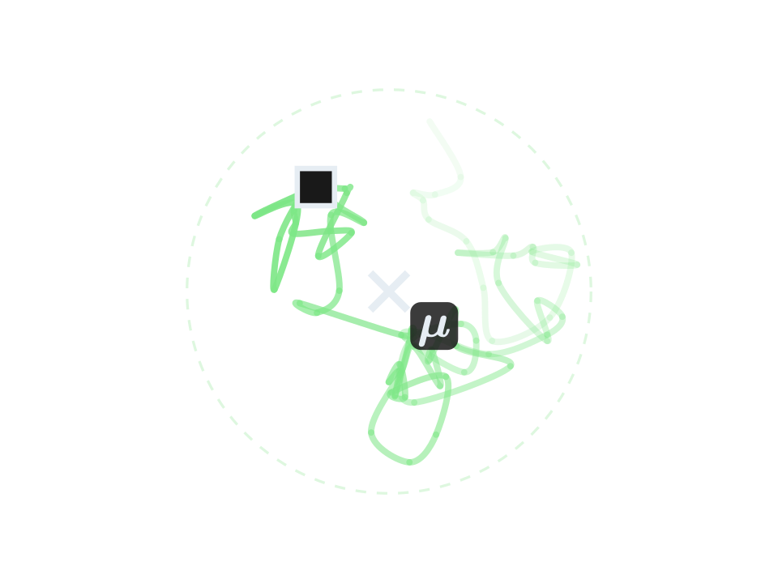{height="285px" style="margin-left: 64px;"}
:::
:::
:::
::::

:::: {.columns .centro .fila-modelo}
::: {.column .eq-modelo .fragment .semi-fade-out fragment-index=4 width="52%"}
**Death**

::: {.processo}
$\displaystyle \underset{\mathbf{x}_i}{\viva} \;\longrightarrow\; \morta$

$\displaystyle d_0 \;+\; g \sum_{j \neq i}
\underset{\substack{\big\uparrow \\ \text{Competition kernel} \\ \text{Gaussian / top-hat}}}
{\color{#ffb86c}{\phi_C(\mathbf{x}_i-\mathbf{x}_j)}}$
:::
:::

::: {.column .fragment .semi-fade-out fragment-index=4 width="45%"}
{height="245px"}
:::
::::
:::::

## Range-resident animal movement

:::: {.columns .centro}

::: {.column width="60%"}
### Ornstein–Uhlenbeck (OU) process

::: {.texto}
Langevin equation:

$$
    \dot{\mathbf{x}}(t) =
    -\frac{1}{\tau}[\mathbf{x}(t) - {\mu}]
    + \sqrt{\frac{2\sigma_r^2}{\tau}}\eta(t).
$$

- $\mathbf{x}$, $\mu$: **animal** position and **home-range center**
- $\tau$: **crossing time**; &emsp;&emsp;$\sigma_r$: **home-range spatial scale**
- $\eta(t)$: **white noise** 

::: {.fragment fragment-index=2}
For discrete time steps, with $\mathcal{Z} \sim \mathcal{N}(0,1)$, the OU process has an exact solution:

$$
    \mathbf{x}(t+\Delta t) =
    \mathbf{x}(t)e^{-\Delta t/\tau}
    +{\mu}(1-e^{-\Delta t/\tau})
    +\sigma_r\sqrt{1-e^{-2\Delta t/\tau}}\,\mathcal{Z}.
$$
:::
:::
:::

::: {.column width="37%"}
::: {.fragment fragment-index=1}

::: {.content-hidden when-meta="sem-python"}
```{python}
#| echo: false
import importlib
import numpy as np
from IPython.display import HTML
import trajetoria_ou as ou
importlib.reload(ou)

semente = ou.SEMENTE if ou.SEMENTE is not None else int(np.random.SeedSequence().entropy % 2**32)
traj = ou.simular_ou(ou.TAU, ou.SIGMA_R, ou.MU, ou.DT, ou.T_FINAL, ou.X0, semente=semente)
HTML(f"<!-- semente: {semente} -->" + ou.svg_animado(traj, ou.MU, largura="100%"))
```
:::

::: {.content-visible when-meta="sem-python"}
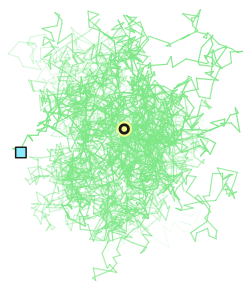{width="100%"}
:::

:::
:::


:::: 


# "Results" (progress)

## IBM Implementation

[Gillespie for demography + discrete steps for movement]{.kicker}

```{.python .spaced code-line-numbers="1-17|2-8|10-17|11|12-16|17|1-17"}
repeat until t = T:
    if animal is D:                         # digesting
    Δt ← Gillespie(death, deposition)
        x_A ← OU jump over Δt               # exact solution
        choose event by its rate:
            death       → a plant dies (competition kernel)
            deposition  → new plant at x_A,  D → F
        t ← t + Δt

    else:                                   # foraging
        Δt ← Gillespie(death)               # schedule the death of a plant
        for each step dt in [t, t + Δt]:
            x_A ← OU jump over dt
            if a plant is within r_e and the animal eats:
                F → D,  t ← time of ingestion
                abort scheduled death
        a plant dies,  t ← t + Δt
```

## Seed Displacement Variance

::: {.r-stack}

::: {.fragment .fade-out fragment-index=2 style="width: 100%; margin-top: 0;"}
::: {.texto}
- Calculate the variance of the distance traveled by a seed.
- Compare it with a Gaussian Kernel variance.
:::

::: {.fragment fragment-index=1}
::: {.texto style="text-align: center;"}
$$
\Delta x = x_d - x_e
$$

$$
  \Delta x =
  x_e\left(e^{-\Delta t/\tau}-1\right)
    +\mu\left(1-e^{-\Delta t/\tau}\right)
    +\sigma_r\sqrt{1-e^{-2\Delta t/\tau}}\mathcal{Z}
$$

$$
\operatorname{Var}(\Delta x) = \operatorname{Var}_{\xe}\!\big(\E{\Delta x \mid \xe}\big) + \mathbb{E}_{\xe}\!\big[\operatorname{Var}(\Delta x \mid \xe)\big]
$$
:::
:::
:::

::: {.fragment fragment-index=2 style="width: 100%;"}
::: {.texto}

::: {.r-stack}
::: {.fragment .fade-out fragment-index=4 style="width: 100%;"}
$$
 \operatorname{Var}(\Delta x) = \frac{2\sigma_r^2}{2+\omega_d\tau} + \frac{\omega_d\tau}{(2+\omega_d\tau)(1+\omega_d\tau)^2} \left[\langle \xe^2\rangle - 2\mu\langle \xe\rangle + \mu^2\right] + \frac{1}{(1+\omega_d\tau)^2}\left[\langle \xe^2\rangle - \langle \xe\rangle^2\right]
$$
:::

::: {.fragment .fade-out fragment-index=5 style="width: 100%;"}
::: {.fragment fragment-index=4}
$$
 \operatorname{Var}(\Delta x) = \frac{2\sigma_r^2}{2+{\color{#f5182b}{\omega_d\tau}}} + \frac{{\color{#f5182b}{\omega_d\tau}}}{(2+{\color{#f5182b}{\omega_d\tau}})(1+{\color{#f5182b}{\omega_d\tau}})^2} \left[\langle \xe^2\rangle - 2\mu\langle \xe\rangle + \mu^2\right] + \frac{1}{(1+{\color{#f5182b}{\omega_d\tau}})^2}\left[\langle \xe^2\rangle - \langle \xe\rangle^2\right]
$$
:::
:::

::: {.fragment fragment-index=5 style="width: 100%;"}
$$
 \operatorname{Var}(\Delta x) = \frac{2\sigma_r^2}{2+{\color{#f5182b}{\beta}}} + \frac{{\color{#f5182b}{\beta}}}{(2+{\color{#f5182b}{\beta}})(1+{\color{#f5182b}{\beta}})^2} \left[\langle \xe^2\rangle - 2\mu\langle \xe\rangle + \mu^2\right] + \frac{1}{(1+{\color{#f5182b}{\beta}})^2}\left[\langle \xe^2\rangle - \langle \xe\rangle^2\right]
$$
:::
:::

::: {.r-stack}
::: {.fragment .fade-out fragment-index=7 style="width: 100%; margin-top: 0;"}
::: {.fragment fragment-index=3}
- ${\color{#bd93f9}{\sigma_r}}$: spatial scale of HR &emsp;&emsp; ${\color{#bd93f9}{\mu}}$: home-range center
- [[${\color{#f5182b}{\tau}}$: HR crossing time &emsp;&emsp;&emsp; ${\color{#f5182b}{\omega_d}}$: digestion rate]{.fragment .fade-out fragment-index=5 style="margin: 0;"} [${\color{#f5182b}{\beta = \omega_d\tau}}$: timescale ratio]{.fragment fragment-index=5 style="margin: 0;"}]{.r-stack}
- $\langle \xe \rangle$, $\langle \xe^2 \rangle$: first and second moments of the eating positions
:::

::: {.fragment fragment-index=5}
$[\omega_d] = T^{-1} \qquad [\tau] = T \qquad \beta =  \omega_d\tau = \frac{\tau}{(1/\omega_d)}$
:::

:::{.fragment fragment-index=6}
- $\beta \ll 1$ - Slow digestion / Rapid exploration
- $\beta \gg 1$ - Fast digestion / Slow exploration
:::
:::

::: {.fragment fragment-index=7 style="width: 100%; margin-top: 0;"}
Under a homogeneous plant distribution, **$\xe \sim p_{\text{st}}$**, so **$\langle \xe \rangle = \mu$** and **$\operatorname{Var}(\xe) = \sigma_r^2$**

$$
\operatorname{Var}(\Delta x)_{\text{H}} = \frac{2\sigma_r^2}{1+\beta}
$$


:::

:::

:::
:::

:::

## Variance of Seed Displacement {transition="fade"}

:::{.texto style="font-size: 0.6em;"}
$$
\begin{align}
&\operatorname{Var}(\Delta x) = \frac{2\sigma_r^2}{2+{\color{#f5182b}{\beta}}} + \frac{{\color{#f5182b}{\beta}}}{(2+{\color{#f5182b}{\beta}})(1+{\color{#f5182b}{\beta}})^2} \left[\langle \xe^2\rangle - 2\mu\langle \xe\rangle + \mu^2\right] + \frac{1}{(1+{\color{#f5182b}{\beta}})^2}\left[\langle \xe^2\rangle - \langle \xe\rangle^2\right]\\[0.1cm]
&\operatorname{Var}(\Delta x)_{\text{H}} =\frac{2\sigma_r^2}{1+\beta}
\end{align}
$$
:::

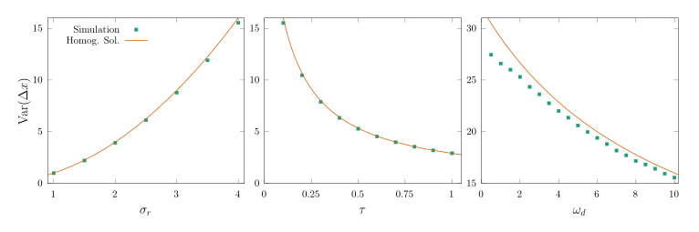{height="220px" style="vertical-align: middle; margin: 0 1em 0 0;"} [Assuming a homogeneous plant distribution]{.texto}

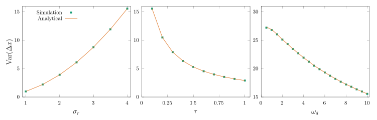{height="212px" style="vertical-align: middle; margin: 0 1em 0 0;"} [General]{.texto}


## Dispersal Kernel

::: {.r-stack}

::: {.fragment .fade-out fragment-index=5 style="width: 100%; margin-top: 0;"}
:::{.texto}
Conditional dispersal kernel $\mathcal{K}^D(\xd \mid \xe)$

:::{.fragment fragment-index=1}
$$
  P(\xd, t+\Delta t \mid \xe, t) = \frac{1}{\sqrt{2\pi\sigma_r^2\left(1-e^{-2\Delta t/\tau}\right)}}\exp\left\{-\frac{\left[\xd-(\mu+(\xe -\mu)e^{-\Delta t/\tau})\right]^2}{2\sigma_r^2(1-e^{-2\Delta t/\tau})}\right\}
$$
:::

:::{.fragment fragment-index=2}
$$
P_d(\Delta t) = \omega_d e^{-\omega_d \Delta t}
$$
:::

:::{.fragment fragment-index=3}
$$
  \mathcal{K}^D\!(\xd \mid \xe) = \int_0^\infty \!\! d(\Delta t)\,
  P\!\left(\xd, t+\Delta t \mid \xe, t\right) P_d(\Delta t)
$$
:::

:::{.fragment fragment-index=4}
$$
\beta = \omega_d \tau \qquad \qquad y_d = \frac{\xd}{\sigma_r} \qquad \qquad y_e = \frac{\xe}{\sigma_r} \qquad\qquad \nu = \frac{\mu}{\sigma_r}
$$
:::
:::
:::

::: {.fragment fragment-index=5 style="width: 100%; margin-top: 0;"}
:::{.texto}
$$
\begin{align*}
  \mathcal{K}^D\!(\xd \mid \xe) &= \frac{1}{\sigma_r}\,\kappa(y_d \mid \nu, y_e, \beta)\\[0.2cm]
  \kappa(y_d \mid \nu, y_e, \beta) &= \frac{\beta}{\sqrt{2\pi}}\int_0^\infty \!\! du\,\frac{e^{-\beta u}}{\sqrt{1-e^{-2u}}} \exp\left\{-\frac{\left[(y_d-\nu)-(y_e -\nu)e^{-u}\right]^2}{2(1-e^{-2u})}\right\}
\end{align*}
$$
:::
:::

:::


## Dispersal Kernel

```{ojs}
//| echo: false
kd = import(new URL("kernel-widget.js", document.baseURI).href)
kd.kernelWidget()
```


# Next steps

## Next steps

:::{.texto}
- Derive SMD equations and compare to IBM

**Perspectives:**

- Characterize spatial patterns and abundance across parameter space
- Coexistence (multiple plant species)
- Gut-passage time distribution closer to ecology (Gamma distributed retention time)
- Many dispersors

:::

## Thank you!

::: {style="text-align: center;"}
Questions?
:::

